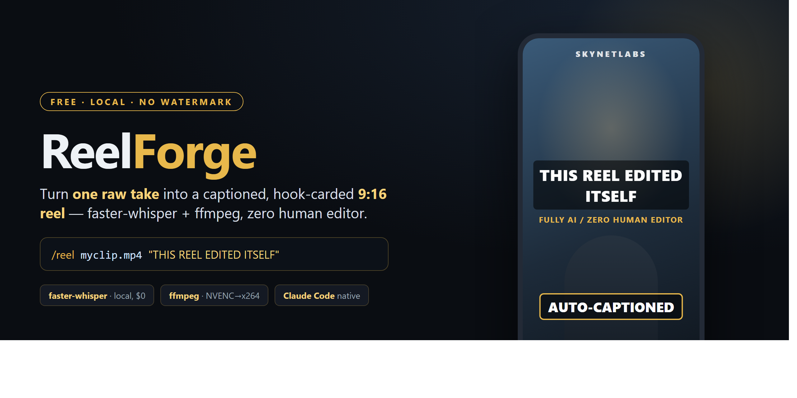

<div align="center">



# ReelForge

### Auto-caption & auto-edit raw clips into vertical 9:16 reels — `faster-whisper` + `ffmpeg`, driven by one Claude Code command.

**Free, local, no watermark, no subscription, no per-clip credits.** A self-hostable, open-source alternative to Opus Clip / SubMagic / CapCut auto-captions — for content creators, freelancers, and indie hackers.

[](LICENSE)
[](https://www.python.org/)
[](CONTRIBUTING.md)
[](https://www.skynetjoe.com)

</div>

---

## Status

Last reviewed: October 2026 · release v2026.10

## What is ReelForge?

**ReelForge is a free, open-source CLI that turns one raw talking-head take into a finished, captioned, hook-carded vertical reel — with no manual editing.** It transcribes locally with `faster-whisper` (no API key, no cloud), burns word-synced captions, drops an on-screen hook card, crops to `1080×1920`, and exports — all from a single command or a Claude Code `/reel` skill.

Unlike "viral clip" tools that need a long podcast and try to _guess_ the good moments, ReelForge assumes you filmed **one intentional take** and just want it shipped. Record → run → publish.

> **The differentiator:** single-take input, a real hook card, baked-in branding, zero config, and Claude Code native. Most open-source tools do none of these.

---

## How do I auto-caption a video? (Quickstart)

### With Claude Code — one command

```bash
npm install -g @anthropic-ai/claude-code        # 1. install Claude Code
git clone https://github.com/waseemnasir2k26/reelforge.git && cd reelforge   # 2. clone
claude                                           # 3. open Claude Code here
```

Then, inside Claude Code:

```
/reel myclip.mp4 "THIS REEL EDITED ITSELF"
```

Claude installs the deps, runs the pipeline, and hands you `reel.mp4`. Done.

### Or run it raw (no Claude Code)

```bash
pip install -r requirements.txt        # faster-whisper
# ffmpeg must be installed and on PATH — https://ffmpeg.org/download.html

python auto_reel.py myclip.mp4 \
  --hook "THIS REEL EDITED ITSELF" \
  --sub  "FULLY AI / ZERO HUMAN EDITOR" \
  --out  reel.mp4
```

---

## How does it work?

```
raw take ──▶ faster-whisper ──▶ word-synced ──▶ hook card ──▶ scale/crop ──▶ ffmpeg ──▶ reel.mp4
 (1 take)   (local, $0, no key)   ASS captions   (drawtext)    1080×1920    NVENC│x264
```

1. **Transcribe** — `faster-whisper` returns word-level timestamps, locally, for free.
2. **Caption** — builds a burned-in ASS subtitle track, snapped to each word.
3. **Hook card** — composites your hook + subline over the first 2.5s.
4. **Reframe** — scales and center-crops any input to vertical `1080×1920`.
5. **Export** — one `ffmpeg` pass via `h264_nvenc` (GPU), auto-falling back to `libx264` (CPU).

---

## Options

| Flag         | Default                        | What it does                                       |
| ------------ | ------------------------------ | -------------------------------------------------- |
| `--hook`     | `THIS REEL EDITED ITSELF`      | on-screen hook card text                           |
| `--sub`      | `FULLY AI / ZERO HUMAN EDITOR` | gold subline under the hook                        |
| `--out`      | `reel.mp4`                     | output file                                        |
| `--model`    | `base`                         | Whisper size: `tiny` / `base` / `small` / `medium` |
| `--hook-len` | `2.5`                          | seconds the hook card shows                        |
| `--wpl`      | `3`                            | words per caption line                             |

---

## FAQ

**Is this a free Opus Clip / SubMagic alternative?**
Yes. ReelForge runs entirely on your machine — no watermark, no subscription, no per-clip credits, no upload limits.

**Does it need an API key or internet?**
No. `faster-whisper` runs locally. The only requirements are Python and `ffmpeg`.

**What ffmpeg command burns subtitles into a vertical video?**
ReelForge does it for you, but under the hood it scales to `1080×1920`, center-crops, and applies a `subtitles=` filter plus a `drawtext` hook card in a single pass.

**Can Claude Code edit my videos and add captions automatically?**
Yes — that's what the bundled `/reel` command and `.claude/skills/reel/SKILL.md` do.

**Does it work without a GPU?**
Yes. It tries NVENC first and automatically falls back to CPU `libx264`.

**What platforms is the output for?**
TikTok, Instagram Reels, YouTube Shorts — any `1080×1920` 9:16 destination.

---

## Requirements

- **Python 3.9+**
- **ffmpeg** on PATH — [download](https://ffmpeg.org/download.html)
- `faster-whisper` (installed via `requirements.txt`)
- GPU optional (NVENC); CPU works via `libx264` fallback

---

## Roadmap

- [ ] Auto silence-trim (cut dead air via `silencedetect`)
- [ ] Karaoke / word-highlight caption style
- [ ] Brand preset file (logo, handle, colors)
- [ ] Batch mode (folder → folder)
- [ ] Per-platform caption packs on export

Contributions welcome — see [CONTRIBUTING.md](CONTRIBUTING.md).

---

## Work with SkynetLabs

Built by [Waseem Nasir](https://www.skynetjoe.com/?utm_source=github&utm_medium=readme&utm_campaign=reelforge) at SkynetLabs — n8n + AI automation for small businesses.

ReelForge is the free, do-it-yourself version. **SkynetLabs** builds the full pipeline for brands — tuned to your voice and platforms, auto-publishing daily, so your team stops editing by hand.

- Hire on Fiverr: https://www.fiverr.com/agencies/skynetjoellc
- Hire on Upwork: https://www.upwork.com/freelancers/muhammadwaseemnasir
- Book a free call: https://calendly.com/skynetlabs/schedule-a-free-consultation

<div align="center">

⭐ **Star this repo** if it saved you an editing session.

`MIT licensed` · © 2026 SkynetLabs · [www.skynetjoe.com](https://www.skynetjoe.com)

</div>
